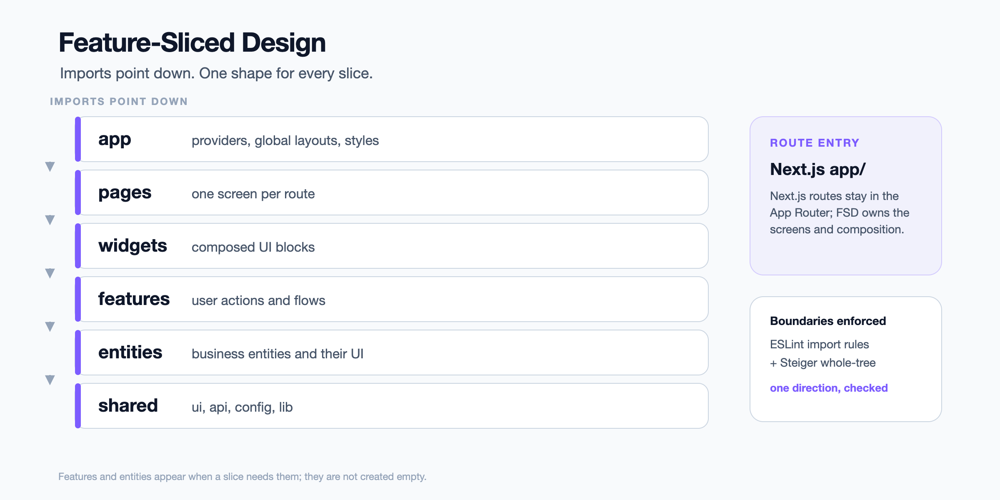

<div align="center">
  
  <h1>nextjs-fsd</h1>
  <p><strong>Next.js that stays on Feature-Sliced Design.</strong></p>
  <p>
    <a href="https://www.npmjs.com/package/@nakedev/nextjs-fsd"></a>
    <a href="https://nodejs.org"></a>
    <a href="https://github.com/NakePranob/nextjs-fsd/actions/workflows/ci.yml"></a>
    <a href="LICENSE"></a>
  </p>
</div>

`nextjs-fsd` is an npm CLI for keeping a **Next.js App Router** project on
**Feature-Sliced Design**. It shapes the layers once, then generates pages,
slices, layouts, and API routes with the same shape — plus the two pieces every
project ends up rewriting by hand: API error handling and authentication.

Next.js already creates projects, so this CLI has no `create`. The workflow is
`create-next-app`, one `nextjs-fsd init`, then the same CLI from the project
whenever the frontend grows.

## Why nextjs-fsd

- **Stop re-deciding where files go.** Layers, public APIs, and import
  boundaries are set once and enforced by two linters.
- **Every slice has the same shape.** Pages, slices, layouts, and API routes are
  generated with the same segments and the same wiring.
- **The cross-cutting wiring is already done.** Auth, API error normalization,
  session handling, and formatting arrive as commands, not as a checklist.

## Quick start

```bash
npm install --global @nakedev/nextjs-fsd
npx create-next-app@latest my-app --ts --app --tailwind --eslint

cd my-app
nextjs-fsd init                # once: FSD layers, both linters, docs
nextjs-fsd add auth            # shared/auth + a login page
nextjs-fsd add prettier        # formatting, with Tailwind class sorting
nextjs-fsd generate page dashboard --auth
```

That gives you a project with `/login` and `/dashboard`, a session guard, and an
API client that normalises every failure into one error type. Then:

```bash
npm run dev
npm run lint                   # eslint (import boundary) + steiger (whole tree)
```

`init` creates no empty layer directories. `features/` and `entities/` appear
when a slice actually needs them — FSD's own advice, not a shortcut.

### Requirements

- **Node.js >=20.9** for the CLI.
- A **Next.js 15 or 16 App Router** project in TypeScript, created by
  `create-next-app`. Both `app/` at the root and `src/app/` are supported.
- npm, pnpm, yarn, or bun. The CLI detects the package manager from the lockfile.
- An HTTP API for `add auth` and `add error-handling`. Both are written against
  the shape `go-scaffold` produces; the full reference explains what to change
  if yours differs.

## What you get

| Area | What `nextjs-fsd` gives you |
| --- | --- |
| **Layers** | `app`, `pages`, `widgets`, `features`, `entities`, and `shared` in the FSD shape, with no empty directories. |
| **Boundaries** | ESLint import rules plus Steiger for the whole tree, so a cross-import fails before review. [See the proof](#proof-it-catches-a-violation). |
| **Generators** | Pages, slices, layouts, and API routes with consistent segments, public APIs, and tests. |
| **Auth** | A login page, session store, access token handling, route guard, and the API client it needs. |
| **Error handling** | One API error type, error catalogs, and the client boundary that normalises failures. |
| **Formatting** | Prettier with Tailwind class sorting. |
| **Agent guidance** | Repository-level `AGENTS.md`, `CLAUDE.md`, and a generated skill that knows the project's paths. |

## CLI or manual setup?

A manual setup gives you the most freedom. It is the right choice when the architecture is intentionally different, the project is a one-off, or you need to own every file from the first commit. The cost is that every convention — layer boundaries, auth wiring, framework path rules — has to be rebuilt and reviewed again.

The CLI is for repetition. It gives the next project the same shape, encodes framework constraints such as the Next.js `app` + `src/pages` collision, and ships boundary checks and agent guidance with the scaffold. It is not automatically faster; a fair speed benchmark has not been run. It is more consistent when more than one person or agent touches the repo.

Use the CLI when repeatability, reviewable boundaries, and a stable target for AI agents matter. Use a manual setup when the architecture itself is the experiment.

## How it fits together



Next.js owns routing. The FSD app layer (`src/_app`) owns providers, global
layouts, and styles. Pages compose widgets, widgets compose features, features
use entities, and everything may use shared. The linters enforce that direction.

## Proof it catches a violation

`shared` is the bottom layer. If it imports `entities` or `pages`, the foundation starts to depend on a screen, becomes harder to test in isolation, and can create circular dependencies. The public `index.ts` rule keeps slices replaceable.

This is a real failure case:

```bash
mkdir -p src/shared/ui
cat > src/shared/ui/leak.ts <<'EOF'
import { Order } from "@/entities/order";
export const leak = Order;
EOF

npm run lint
# exit 1
# src/shared/ui/leak.ts:1
# no-restricted-imports
```

`npm run lint` stops at ESLint. Run Steiger separately to see its rule:

```bash
npx steiger ./src
# exit 1
# fsd/forbidden-imports
# Forbidden import from higher layer "entities"
```

Remove the probe, or change it to a shared import:

```bash
npm run lint
# exit 0
```

**What this catches:** wrong-direction alias imports and whole-tree FSD structure. **What it does not catch:** dynamic imports, runtime dependency injection, same-layer coupling, and server-side authorization.

## Same input, same output

Measured pilot, not yet a CI gate: three clean copies of the same base, the same CLI version, and the same flags.

- 38 files in each run
- manifest `0ea89b20…`
- A↔B diff: 0
- A↔C diff: 0
- editing one generated file produced an 11-line manifest diff

The manifest is every generated file's relative path plus its SHA-256, excluding `node_modules`, `.git`, `.next`, `.svelte-kit`, and `build`.

## Generated project

```text
src/
├─ app/                      # Next.js App Router routes
├─ _app/                     # FSD app layer: providers, layouts, styles
├─ pages/                    # one folder per route screen
├─ widgets/                  # composed UI blocks
├─ features/                 # user actions
├─ entities/                 # business entities
└─ shared/                   # api, auth, config, ui, lib
```

`features/` and `entities/` are not created empty; they appear when a slice
needs them.

## Commands

| Command | What it does |
| --- | --- |
| `init` | Shape a Next.js project into FSD layers, add linters and docs. |
| `generate page [name]` | Add a route page with its slice and wiring. |
| `generate slice [layer] [name]` | Add a `features` or `entities` slice. |
| `generate layout [name]` | Add shared chrome for a route group. |
| `generate api-route [name]` | Add a Route Handler with its logic in `_app`. |
| `add auth` | Add password login, session handling, and a login page. |
| `add error-handling` | Add the API error boundary and error catalogs. |
| `add prettier` | Add formatting with Tailwind class sorting. |
| `config` | Inspect and change project settings. |

Run any command with `--help` for its current options. The full command
reference — wizard behavior, every option, generated output, and assumptions —
lives in [`REFERENCE.md`](REFERENCE.md).

## Auth: beta

`add auth` generates the client-side session flow: login page, in-memory access token, refresh handling, session guard, and API error boundary. It is beta: generated projects exercise it, but it has not been audited for production.

**What you still own:** server-side authentication and authorization, CSRF/CORS/cookie policy, token lifetime, and the API contract. The client guard is UX, not authorization.

## What this does not cover

- A production security audit
- Server-side authorization tests
- Dynamic imports and runtime dependency injection
- Every possible FSD coupling; same-layer cross-slice review remains

## Learn more

- [Full command reference](REFERENCE.md)
- [Source, template, and test workflow](AGENTS.md)
- Sibling projects: [`go-scaffold`](https://www.npmjs.com/package/@nakedev/go-scaffold) and [`sveltekit-fsd`](https://www.npmjs.com/package/@nakedev/sveltekit-fsd)

## Development

```bash
pnpm install --frozen-lockfile
pnpm run build
pnpm run test
```

See [`AGENTS.md`](AGENTS.md) for the source/template/test workflow and the
release contract.

## License

MIT — see [LICENSE](LICENSE).
